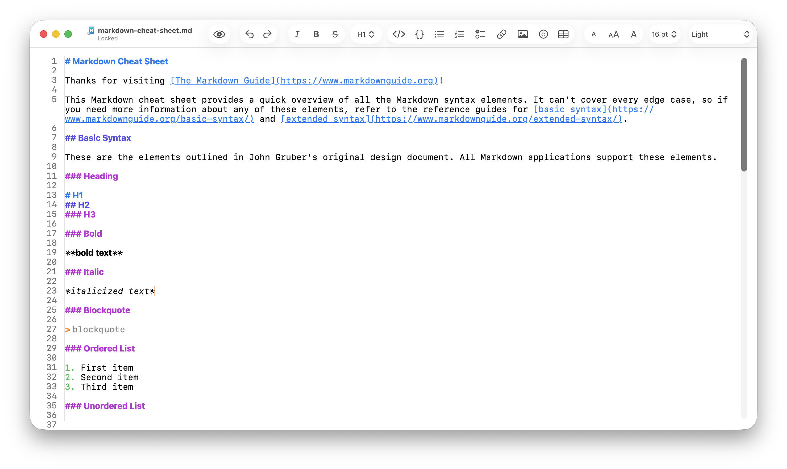

# MarkdownEditor

MarkdownEditor is a simple and user-friendly macOS app for editing (and previewing) Markdown files. It provides (a live preview,) image support, and table editing features to make working with Markdown documents efficient.



## Features
- Edit (and preview) Markdown files in real time
- Insert and manage images; local images next to the document show up in the preview (`` or ``)
- Table editing support
- Find and replace (⌘F, ⌥⌘F)
- Clean and intuitive interface

## Installation

### Prebuilt DMG
A ready-to-run build is available on the [Releases](https://github.com/dirkclemens/MarkdownEditor/releases/latest) page as `MarkdownEditor.dmg` (ad-hoc signed, Apple Silicon only). Since it isn't notarized by Apple, macOS blocks it on first launch. Remove the quarantine flag before opening:

```bash
xattr -dr com.apple.quarantine /Applications/MarkdownEditor.app
```

### Build from source
1. Clone the repository:
   ```bash
   git clone https://github.com/dirkclemens/MarkdownEditor.git
   ```
2. Open `MarkdownEditor.xcodeproj` in Xcode.
3. Build and run the app on your Mac.

## Requirements
- macOS 26.0 or later
- Xcode 26 or later

## Folder Structure
- `MarkdownEditor/` – Main app source code

The editor component, themes and the Markdown-to-HTML converter live in the
Swift package [MarkdownEditorKit](https://github.com/dirkclemens/MarkdownEditorKit),
which is shared with [xNotes](https://github.com/dirkclemens/xNotes).

## License
MIT License

---

Feel free to contribute or open issues for suggestions and bug reports!
